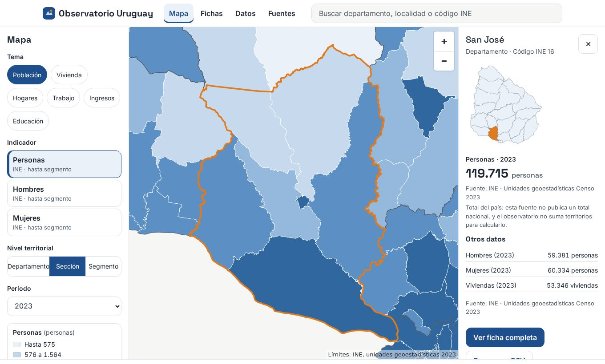
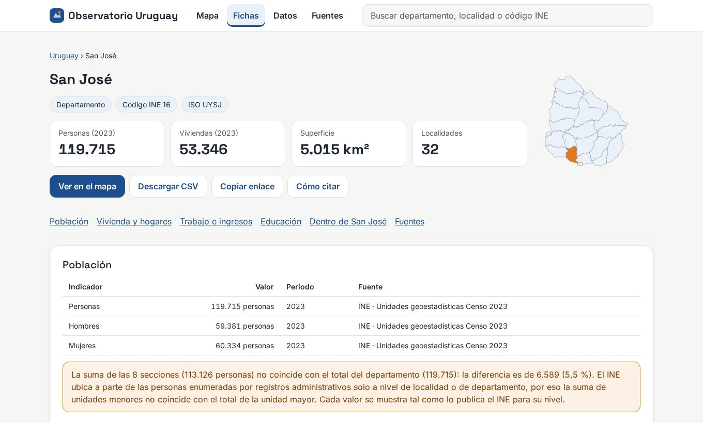
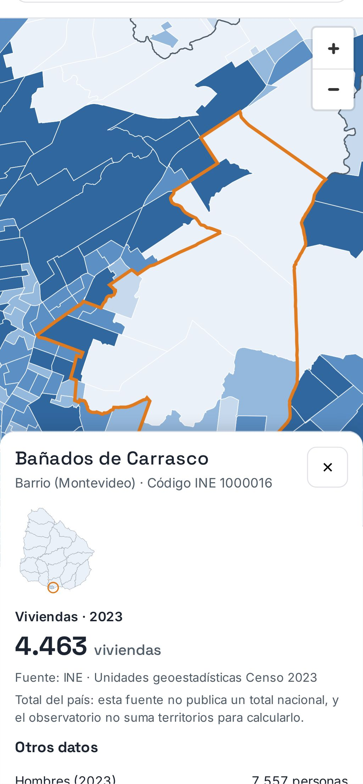

# Observatorio Uruguay

Reúne datos públicos sobre el territorio uruguayo, los guarda en una base propia y los vincula a un territorio (departamento, sección, segmento, localidad).

**Sitio:** https://martintraverso.github.io/observatorio/ · **Datos:** [último release](https://github.com/martintraverso/observatorio/releases/latest)

| Mapa | Ficha | Móvil |
|---|---|---|
|  |  |  |

## Fase 0: territorios del Censo 2023

Carga las unidades geoestadísticas que publica el INE y sus conteos del Censo 2023 (personas, hombres, mujeres, viviendas).

| Nivel | Cantidad | Código INE |
|---|---:|---|
| Departamento | 19 | 2 caracteres (Montevideo = 01) |
| Sección censal | 236 | 4 (depto + sección) |
| Segmento censal | 4.538 | 7 (+ segmento) |
| Localidad censal | 652 | 5 (depto + localidad; 900 = rural) |
| Barrio (Montevideo) | 63 | código INE de barrio |
| CCZ (Montevideo) | 18 | número de CCZ |

El paquete del INE no incluye zonas censales: el nivel más fino es el segmento.

### Cómo correrlo

Requiere Python 3.12.

```bash
python3.12 -m venv .venv && source .venv/bin/activate   # o: uv venv -p 3.12 .venv
pip install -r requirements-dev.txt                      # runtime + ruff

# Bajar el zip de https://www.gub.uy/instituto-nacional-estadistica/politicas-y-gestion/unidades-geostadisticas
# y guardarlo en datos/crudo/ (no se sube a git)
python pipeline/territorios_2023.py datos/crudo/Unidades_Geoestadisticas_Censo_2023.zip
python pipeline/web.py                                   # archivos para la app (necesita tippecanoe)
```

El primer paso tarda unos 15 segundos; el segundo, unos 30. Los resultados quedan en `datos/salida/`:

| Archivo | Qué tiene |
|---|---|
| `observatorio.duckdb` | Todo junto. Empezá por la vista `v_observaciones` (o `v_publicadas`: solo fuentes activas, lo que muestra la app). `indicadores_web` trae el cuadro, el corte de serie, el nivel educativo y los niveles y períodos con datos de cada indicador. |
| `territorios.parquet` | Un registro por territorio, con geometría completa (GeoParquet). |
| `observaciones.parquet` | Indicador, territorio, período, valor y captura de origen. |
| `correspondencias.parquet` | Relaciones entre territorios (segmento → localidad). |
| `capturas.parquet` | La captura de la que salen las observaciones actuales (archivo, sha256, fecha). |
| `capturas_historial.parquet` | Una fila por corrida: `nuevo`, `reprocesado`, `sin cambios` o `error`. Solo se le agregan filas. |
| `fuentes.parquet` | El registro de fuentes (todos los `fuentes/*.yml`). |
| `web/` | Archivos para la app: ver abajo. |
| `reporte_validacion.md` | Controles de calidad. Revisalo después de cada corrida. |

Si el original no cambió (mismo sha256 que la última captura procesada) y las salidas están completas, el pipeline no reprocesa: anota la corrida como `sin cambios` y termina. Para reprocesar igual, agregá `--forzar`. Si algún control falla, sale con código 1, lista las fallas en stderr y anota la corrida como `error`.

Ejemplo de consulta:

```sql
-- duckdb datos/salida/observatorio.duckdb
SELECT territorio, nivel, valor
FROM v_observaciones
WHERE indicador = 'pob_total' AND depto = '16' AND nivel IN ('departamento', 'seccion')
ORDER BY nivel, codigo;
```

### Archivos para la app (`datos/salida/web/`)

`pipeline/web.py` los arma a partir de los Parquet; la app es estática y no necesita servidor.

| Archivo | Qué tiene |
|---|---|
| `territorios.pmtiles` | Teselas vectoriales con una capa por nivel (zoom 0–13). Los segmentos aparecen desde el zoom 9. |
| `<nivel>.geojson` | Todos los niveles menos segmento, simplificados sin abrir huecos entre vecinos (≤ 2 MB, 5 decimales). |
| `territorios_index.json` | Índice de búsqueda: id, nivel, código, nombre, `nombre_busqueda` (sin tildes), depto, padre y bbox. |
| `fichas/<nivel>/<codigo>.json` | Todo lo que muestra la ficha: identidad, padres, contenidos, relaciones y observaciones con su fuente. |
| `indicadores.json`, `fuentes.json`, `capturas.json` | Catálogos e historial de capturas. |
| `manifest.json` | Cada archivo con tamaño, sha256 y fecha de generación. |

**tippecanoe** arma el PMTiles. CI usa la **2.53.0** (fijada en `.github/actions/tippecanoe`): otra versión da teselas distintas. En Debian 13: `sudo apt install tippecanoe` (trae la 2.53.0). Sin `sudo`, se puede extraer el paquete en el usuario:

```bash
mkdir -p ~/.local/opt/tippecanoe && cd ~/.local/opt/tippecanoe
apt-get download tippecanoe && dpkg-deb -x tippecanoe_*.deb .
ln -sf ~/.local/opt/tippecanoe/usr/bin/tippecanoe ~/.local/bin/tippecanoe
```

Sin tippecanoe, `python pipeline/web.py --sin-pmtiles` arma todo lo demás y los tests de PMTiles se saltean (en CI son obligatorios).

### Lint y tests

```bash
ruff check .
pytest -q                                   # sobre el fixture (lo mismo que corre CI)
OBS_DATOS=completo pytest -q                # sobre datos/salida/ (correr antes el pipeline y web.py)
python scripts/verificar.py                 # solo lo que tocan los cambios de la rama (--plan para ver, --todo para todo)
```

`scripts/verificar.py` compara con `origin/main`: si solo cambió `app/`, no rehace la web ni corre pytest; si solo cambiaron `tests/` o `scripts/`, corre ruff y el fixture; `pipeline/` y `fuentes/` suman `web.py` y los datos completos; `pipeline/web.py` suma también la app. Solo docs: nada. `web.py` arma la web desde los Parquet de `datos/salida/`: si cambiaste un cargador, corré antes su script.

- **Fixture** (`OBS_DATOS=fixture`, por defecto): `tests/fixtures/ine_2023_mini.zip` es un recorte del zip del INE (~1 MB): departamentos 01, 02 (con el límite contestado), 07 y 16; secciones, segmentos y localidades de Flores; barrios y CCZ de Montevideo. Los atributos son los originales; las geometrías están simplificadas (~10 m). Los tests corren el pipeline sobre él en una carpeta temporal, sin pasos previos.
- **Completo** (`OBS_DATOS=completo`): usa la salida en `datos/salida/`. Si no existe, los tests fallan.

Los controles del pipeline comparan con un archivo de valores esperados (`--esperado`). Por defecto es `pipeline/esperado/ine_2023_completo.yml`; el fixture trae el suyo en `tests/fixtures/esperado.yml`.

Para regenerar el fixture (por ejemplo, si el INE publica una versión nueva del zip):

```bash
python scripts/crear_fixture.py datos/crudo/Unidades_Geoestadisticas_Censo_2023.zip
```

### Agregar una fuente

1. Un archivo `fuentes/<id>.yml` con: `archivo_original` y `script` (si está activa), `id`, `nombre`, `organismo`, `pagina`, `url_descarga`, `formato`, `licencia` (texto exacto de la fuente), `frecuencia`, `estado` (`activa`, `en preparación` o `a relevar`), `temas`, `niveles_publicados`, `nivel_mas_detallado`, `notas`, y `version_geo` si trae geometrías. El pipeline no arranca si algún registro está incompleto.
2. Un script `pipeline/<fuente>.py` que use `pipeline/comun/` (huella, capturas e historial, controles, salida). `territorios_2023.py` sirve de modelo.
3. Tests sobre un fixture chico de esa fuente.

### La app

`app/` es un sitio estático (SvelteKit) que lee los archivos de `datos/salida/web/` y se publica en GitHub Pages. Ver `app/README.md`.

Controles de calidad que corren en cada PR y antes de cada deploy:

- **Accesibilidad:** axe sin violaciones serias ni críticas en todas las pantallas, teclado, áreas táctiles de 44 px, contraste (AC-G5).
- **Rendimiento:** Lighthouse móvil ≥ 80 en el inicio (mediana de 3 corridas) y JS inicial ≤ 300 KB comprimido sin MapLibre (AC-G6).
- **Navegadores:** Chromium, Firefox y WebKit (Safari), escritorio y móvil a 390 px sin scroll horizontal (AC-G4).

```bash
cd app && npm ci && npm run dev
```

### Reglas que sigue la base

- **Cada dato se guarda en el nivel en que se publica.** La población de un departamento no es la suma de sus secciones: el INE ubica a parte de las personas (enumeración administrativa) solo a nivel de localidad o departamento. En 2023 la diferencia total es de 157.929 personas. Ver `reporte_validacion.md`.
- **Cada valor apunta al archivo del que salió** (`captura_id` → nombre del archivo, sha256 y fecha).
- **Las geometrías tienen versión** (`version_geo = INE-2023`). Cuando se carguen las de 2011, conviven con estas.
- El polígono "LIMITE CONTESTADO" del INE se guarda como `area_especial` y no lleva conteos propios.

### Automatización

- `.github/workflows/ci.yml` corre `ruff check` y `pytest` (sobre el fixture, con PMTiles) en cada push y pull request.
- `.github/workflows/datos.yml` procesa y publica los datos: a mano (Actions → *Datos · procesar y publicar* → *Run workflow*, con la opción *forzar*), cada lunes, y al mergear a `main` cambios en `pipeline/` o `fuentes/` (reprocesa).

Cada corrida de `datos.yml`:

1. baja de la última publicación el historial de capturas y las salidas (`scripts/publicar.py bajar`);
2. baja cada original del release `crudos`; si no está, de la URL de la fuente, y lo agrega a `crudos` (`scripts/conseguir_originales.py`);
3. procesa todo con un solo comando (`pipeline/correr.py`): cada fuente activa y, si algo cambió, `web.py`;
4. si hubo cambios, corre los tests con los datos completos y publica un release nuevo `datos-AAAAMMDD-HHMMSS`: se crea como borrador, se suben todos los archivos y recién entonces se marca como *latest*. Si no hubo cambios, solo actualiza el historial y el reporte de la última publicación.

Si algo falla, la corrida queda en rojo, el borrador se borra y el *latest* anterior queda intacto. GitHub avisa por mail de las corridas programadas que fallan a quien modificó por última vez el workflow (configurable en *Settings → Notifications → Actions*).

Los datos publicados siempre están en `https://github.com/<usuario>/<repo>/releases/latest/download/<archivo>`: tablas en Parquet, `observatorio.duckdb`, `reporte_validacion.md`, `web.zip` y `manifest.json`. Las publicaciones anteriores quedan como releases `datos-…`.

Para correr lo mismo en local:

```bash
python scripts/conseguir_originales.py --sin-subir   # o copiar el zip a datos/crudo/
python pipeline/correr.py                            # --forzar para reprocesar igual
```

#### Release `crudos`

Guarda los originales tal como se descargaron. Lo crea la primera corrida si no existe; para crearlo a mano (una vez, con [GitHub CLI](https://cli.github.com/) autenticado):

```bash
gh release create crudos datos/crudo/Unidades_Geoestadisticas_Censo_2023.zip --latest=false \
  --title "Archivos originales" \
  --notes "Archivos originales tal como se descargaron de cada fuente. No se modifican ni se reemplazan."
```

Para agregar otro original: `gh release upload crudos RUTA_AL_ARCHIVO` (sin `--clobber`). Los originales son inmutables: si la fuente publica una versión nueva con el mismo nombre, se sube con otro nombre y se actualiza `archivo_original` en `fuentes/<id>.yml`.

## Fuente y licencia de los datos

Instituto Nacional de Estadística (INE), Unidades geoestadísticas Censo 2023. Según sus metadatos: *"El uso es libre, citando como fuente al INE."* Contacto de cartografía: cartogra@ine.gub.uy.
